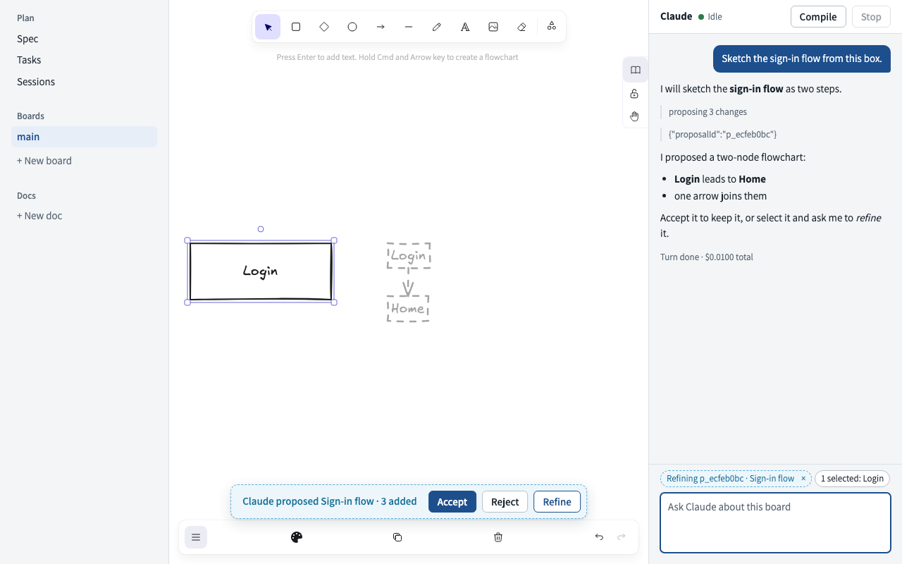

# Blueprint design

## Feel

Blueprint is a drafting table: a plain sheet of paper, ruled margins, and ink, with the board as the drawing in the middle.
Your actions are in Prussian blue, the pigment a real blueprint is printed in, and Claude's work is in non-photo blue, the pencil a draftsman sketches with because it does not reproduce until someone inks it.
The chrome stays quiet so the hand-drawn board carries the personality, and the one bold move is that dashed, light-blue line meaning "Claude proposed this and it is not yours yet".

The tokens live at the top of [`src/ui/styles.css`](src/ui/styles.css).
Every color, font size, radius, and shadow in that file comes from one of them.

## Type

The interface is set in Assistant, the face Excalidraw uses for its own toolbar, so the panel and the canvas chrome read as one piece.
Code, branch names, task file names, and citation chips are set in Cascadia Code.
Both faces are served from `/fonts`, copied in from Excalidraw's package at build time, so nothing loads from the network.

| Token     | Size | Use                                                                                  |
| --------- | ---- | ------------------------------------------------------------------------------------ |
| `--fs-xs` | 12px | Meta lines, branch tags, status pills, code blocks                                   |
| `--fs-sm` | 13px | Tool rows, chips, the status strip, sidebar section names                            |
| `--fs-md` | 15px | Body text, buttons, inputs, Claude's headings below the top level                    |
| `--fs-lg` | 17px | Card titles, Claude's top-level heading, a second-level heading in the spec and docs |
| `--fs-xl` | 22px | The top-level heading in the spec and docs                                           |

Body text uses a line height of 1.5.
Weights are 400 for text, 600 for buttons and labels, and 700 for titles.
Section names in the sidebar are sentence case, not tracked capitals.

## Color

| Token             | Value     | Role                                                                                                     |
| ----------------- | --------- | -------------------------------------------------------------------------------------------------------- |
| `--bg`            | `#ffffff` | Paper: the main area, cards, inputs                                                                      |
| `--surface`       | `#f3f5f7` | The sidebar, the panel, and inset areas such as a run's transcript                                       |
| `--border`        | `#dbe1e7` | Rules between regions and around cards                                                                   |
| `--border-strong` | `#b6c0ca` | Controls: buttons, inputs, chips, the quote rule                                                         |
| `--text`          | `#17212b` | Ink for all body text                                                                                    |
| `--muted`         | `#5a6774` | Secondary text: meta lines, tool rows, placeholders, an idle run                                         |
| `--on-accent`     | `#ffffff` | Text on an accent fill                                                                                   |
| `--accent`        | `#1d4f8c` | Prussian blue: your actions, links, focus rings, your messages, the open page                            |
| `--accent-hover`  | `#163f71` | A primary button under the pointer                                                                       |
| `--accent-tint`   | `#e7eef7` | The open page in the sidebar, the citation chip                                                          |
| `--ghost`         | `#5aaed8` | Non-photo blue line: the dashed edge of anything Claude proposed and you have not accepted               |
| `--ghost-tint`    | `#edf6fb` | The fill behind a ghost line                                                                             |
| `--ai`            | `#136f96` | AI-made: the solid ink of Claude's own words and state, such as the proposal summary and the Working dot |
| `--ok`            | `#2c7a4b` | Idle in the panel, a run that is Done                                                                    |
| `--warn`          | `#9a5c08` | Needs you, and a citation the spec dropped                                                               |
| `--warn-tint`     | `#fdf4e7` | The fill of a permission dialog                                                                          |
| `--danger`        | `#bd3a2a` | Errors and a failed run                                                                                  |
| `--code-bg`       | `#eef1f4` | Inline code and branch tags                                                                              |

Text colors meet a 4.5 to 1 contrast ratio on the surfaces they sit on.
`--ghost` is a line color only; text in the ghost family uses `--ai`.
Excalidraw's own toolbar keeps its own colors, and the canvas draws ghosts itself (see below).

## Spacing and radius

Spacing is a multiple of `--space`, which is 8px: 4, 8, 12, 16, 20, and 24 pixels.
Rows inside a region are 8px apart, regions are padded 16px, and full pages are padded 24px.

| Token           | Value | Use                                                                         |
| --------------- | ----- | --------------------------------------------------------------------------- |
| `--radius-sm`   | 4px   | Inline code, branch tags, citation chips                                    |
| `--radius`      | 6px   | Buttons, inputs, sidebar links, dialogs inside a card, the transcript inset |
| `--radius-lg`   | 10px  | Cards and the floating proposals bar                                        |
| `--radius-pill` | 999px | Chips, status pills, status dots                                            |

There is one shadow, `--shadow-float`, and only the proposals bar uses it, because only it floats over the canvas.

## Components

### Ghost styling and the proposals bar

On the canvas a proposal is drawn as ghosts: added and changed elements at 40 percent opacity with a dashed stroke, and removed ones in red.
That is Excalidraw element styling, set in [`src/ui/board/ghosts.ts`](src/ui/board/ghosts.ts), and this design pass leaves it alone.
The proposals bar repeats the ghost's language around it: a `--ghost-tint` fill with a dashed `--ghost` border, the summary in `--ai`, and the floating shadow.
Accept is the one primary button, because it is the action that turns a ghost into ink.
Reject and Refine are plain buttons beside it.

### Selection and refine chips

The selection chip is solid, with a `--border-strong` edge and ink text, because the selection is yours.
The refine chip is dashed in `--ghost` on `--ghost-tint` with `--ai` text, because it names one of Claude's proposals.
Both sit above the composer, wrap when they run out of room, and truncate a long label with an ellipsis.

### Permission dialog

Claude is waiting on you, so the dialog wears `--warn`: a 1px border with a 4px left edge and a `--warn-tint` fill.
The tool name is bold and the summary follows it on the same line.
The three choices are plain buttons of equal weight, so neither Allow nor Deny is the easy default.
The same component appears in the panel, inset from its edges, and in a run card.

### Status strip

The panel header pairs the title with a dot and a word.
Idle is `--ok`, Working is `--ai` and pulses gently unless reduced motion is set, Needs you is `--warn` in bold, and Error is `--danger`.
Starting and Stopped have a neutral dot.

### Run cards

A run card is a paper card with a `--radius-lg` corner, its title in `--fs-lg`, and a status pill on the right.
The pill uses the same dot colors as the status strip; Done is `--ok`, Failed is `--danger`, an idle run is `--muted` because it waits on you without being finished, and Interrupted is a hollow ring.
A run that needs you also gets a `--warn` pill border and fill, so it stands out in a grid.
The meta line holds the slug, the branch as a code tag, the running cost, and the PR link.
The sessions page is one column up to 1120px wide; cards fill it in a grid with a 400px minimum, so a lone card takes the whole width and two sit side by side.
The rate-limit note and the other sessions list share the grid's edges.

### Spec view and its citations

The spec is read-only, so it reads as a document, not an editor: the same Markdown renderer as the panel, on paper, at a 72-character measure with a line height of 1.6.
Its top-level heading is `--fs-xl`, a second-level heading is `--fs-lg`, and blocks are 12px apart with 24px above each heading.
A citation such as `[[board:main#login]]` is a small link chip labelled `main#login`: Cascadia Code at `--fs-xs`, `--accent` on `--accent-tint`, a `--radius-sm` corner, and the raw citation as its tooltip.
A chip gains an `--accent` border on hover and opens the board element or doc heading it names.
A citation that no longer resolves is listed in the header in `--warn`.
Split into tasks is the one primary button, in the same header.

### Doc editor

Docs stay editable in CodeMirror, with a highlight style of its own in place of CodeMirror's default.
Headings are bold and not underlined; the top level is `--fs-xl` and the second level is `--fs-lg`.
Markdown marks such as `#` and `**` are `--muted`, links are `--accent`, and code is Cascadia Code.
The gutter sits on `--surface` behind a `--border` rule.

### Tasks view cards

A task card has the same paper, border, and corner as a run card.
The file name sits on top in Cascadia Code at `--fs-xs`, then the title in `--fs-lg`, the dependencies, the acceptance list, and the sources as the same citation chips as the spec.
Launch opens its dialog inline in the card on a `--surface` inset, and the dialog's Launch is the primary button.

### Claude's Markdown

Assistant text is rendered by [`src/ui/markdown.tsx`](src/ui/markdown.tsx) into React elements, so HTML in Claude's text is shown as text.
Paragraphs, headings, emphasis, inline code, fenced code, lists, links, and block quotes are rendered; anything else stays as written.
A single newline is a line break, because Claude often writes a sentence per line.
Headings start at `h3` below the panel's own `h2`, and a top-level heading is `--fs-lg`.
Code blocks scroll sideways rather than wrap.
Links open in a new tab with `rel="noreferrer"`, and only `http`, `https`, and `mailto` links become links.
A citation stays text unless the caller passes `renderCitation`, which the spec view uses for its chips.

## Before and after

Each pair was taken at 1280 by 800 with the built app on the fake SDK.

| View                               | Before                                          | After                                         |
| ---------------------------------- | ----------------------------------------------- | --------------------------------------------- |
| The board with a pending proposal  | [before](docs/design/before-board-proposal.png) | [after](docs/design/after-board-proposal.png) |
| The panel mid-answer with Markdown | [before](docs/design/before-panel-markdown.png) | [after](docs/design/after-panel-markdown.png) |
| The spec view                      | [before](docs/design/before-spec.png)           | [after](docs/design/after-spec.png)           |
| The tasks view                     | [before](docs/design/before-tasks.png)          | [after](docs/design/after-tasks.png)          |
| The sessions view                  | [before](docs/design/before-sessions.png)       | [after](docs/design/after-sessions.png)       |
| A doc in the editor                | (none taken)                                    | [after](docs/design/after-doc.png)            |

