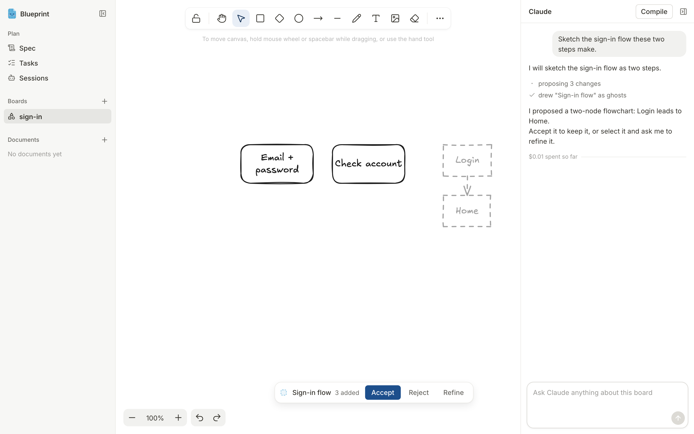

#  Blueprint

Blueprint is a planning whiteboard for Claude Code. It runs locally in one of your repositories and opens in your browser.

Sketch on boards and write in documents, ask Claude about what you selected, and accept or reject the shapes it proposes. When the plan is ready, Blueprint turns it into a spec and tasks, then runs one Claude Code session per task in its own git worktree.



## Requirements

- macOS or Linux (Windows is untested)
- Node 22.1+ and pnpm (`corepack enable` installs the pinned version)
- git
- Claude Code, logged in once with `claude`
- Optional: the GitHub CLI `gh`, logged in, so runs can open pull requests

## Install

```sh
git clone https://github.com/vincent65/cursor-whiteboard.git ~/blueprint
cd ~/blueprint
pnpm install
pnpm build
pnpm link --global   # adds a `blueprint` command; run `pnpm setup` first if pnpm asks
```

## Run

From the root of the repository you want to plan in:

```sh
blueprint
```

Blueprint creates `.blueprint/`, adds its ignored paths to `.gitignore`, and opens http://localhost:4242.

| Option       | Does                                  |
| ------------ | ------------------------------------- |
| `--port <n>` | Serves on another port                |
| `--no-open`  | Skips opening the browser             |
| `init`       | Creates `.blueprint/` without serving |

Without the global link, run `node ~/blueprint/dist/cli/index.js` instead.

## How it works

1. **Sketch.** Press **+** next to Boards or Documents, name it, and start drawing or writing. Pasted images are saved in `.blueprint/assets/`.
2. **Ask.** Select shapes and type in the Claude panel. Claude answers in text, or proposes shapes that appear as dashed outlines next to your selection.
3. **Decide.** **Accept** keeps the proposal, **Reject** removes it, and **Refine** asks Claude to change it. Nothing Claude proposes stays on the board until you accept it.
4. **Compile.** **Compile** writes `.blueprint/spec.md` from your boards and documents. Each citation in the spec opens the shape or heading it came from.
5. **Split.** **Split into tasks** writes one file per task in `.blueprint/tasks/`, with dependencies, files, and acceptance criteria.
6. **Launch.** **Launch** on a task starts a Claude Code session on a new branch, `blueprint/<slug>`, in its own worktree. A task whose dependencies are not merged yet needs **Launch anyway**.
7. **Watch.** **Sessions** shows a card per run with its status, transcript, and a message box. When a run asks to use a tool, its card reads **Needs you** until you allow or deny it. Each run commits, pushes, and opens a pull request with `gh` when it can; otherwise its work stays committed on its branch. **Mark done** finishes a run.

Recorded walkthroughs, made with the fake SDK: [plan, ask, and accept](docs/demo/01-plan-ask-accept.webm), [compile and split](docs/demo/02-compile-split.webm), [launch a run](docs/demo/03-launch-run.webm).

## Your Claude login

Blueprint holds no credentials and calls no API itself. It drives Claude Code through Anthropic's Agent SDK on your own login, so it uses your plan like a terminal session does.

Anthropic's Agent SDK terms reserve claude.ai login for first-party products, and Blueprint is not one. It is a personal tool, not a service; if you run it on your login, that is your call.

## Try it without Claude

The fake SDK replays a scripted scenario instead of calling Claude. From the clone:

```sh
cd ~/blueprint
BLUEPRINT_FAKE_SDK=e2e/scenario.json node dist/cli/index.js
```

From another repository, pass the full path: `BLUEPRINT_FAKE_SDK="$HOME/blueprint/e2e/scenario.json" blueprint`.

The scenario always proposes the same Login and Home flowchart, compiles a fixed spec, and splits it into two tasks. Name your board `main` so the spec's citation opens the right shape. A launched run creates a real branch and worktree, so clean up afterwards:

```sh
git worktree remove --force .blueprint/worktrees/login-page
git branch -D blueprint/login-page
rm -rf .blueprint
```

## What's in `.blueprint/`

| Path                            | Holds                                   | In git    |
| ------------------------------- | --------------------------------------- | --------- |
| `boards/<name>.excalidraw.json` | Board scenes (images stored separately) | Committed |
| `assets/<sha256>.<ext>`         | Pasted images and files                 | Committed |
| `docs/<name>.md`                | Documents                               | Committed |
| `spec.md`                       | The compiled spec                       | Committed |
| `tasks/<nn>-<slug>.md`          | One task per file                       | Committed |
| `sessions.json`                 | The plan session and its runs           | Committed |
| `proposals.jsonl`               | Every proposal and its outcome          | Committed |
| `export/`                       | Board exports Claude reads              | Ignored   |
| `worktrees/<slug>/`             | One worktree per run                    | Ignored   |

Blueprint writes these files but never commits them; commit them like any other change.

## Known limitations

- Claude Code runs read-only commands like `ls` without asking, so they never show up as a request.
- Each task launches once; to retry a failed run, message it on its card.
- Dependencies count as merged only when their branch is an ancestor of yours, so squash or rebase merges need **Launch anyway**.
- Blueprint never deletes worktrees or branches. To relaunch a broken run: `git worktree remove --force .blueprint/worktrees/<slug>` and `git branch -D blueprint/<slug>`.
- Run one Blueprint per repository.

## Development

```sh
pnpm dev                               # server on :4242 with reload, UI on :5173
pnpm check                             # type checks, Biome, unit tests
pnpm exec playwright install chromium  # once, before e2e
pnpm e2e                               # end-to-end flows against the fake SDK
pnpm demo                              # the same flows, recorded to docs/demo/
```

`pnpm dev` plans in the clone itself. The original design notes are in [docs/build-plan.md](docs/build-plan.md); the UI's design system is in [DESIGN.md](DESIGN.md).

## Acknowledgments

Boards are drawn with [Excalidraw](https://github.com/excalidraw/excalidraw) (MIT). Icons are from [Lucide](https://lucide.dev) (ISC).
