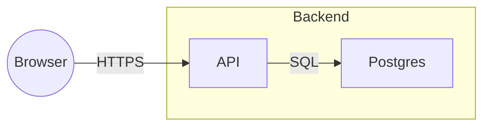

### Task 3: Markdown renderer with golden fixture

**Files:**
- Create: `src/export/markdown.ts`, `test/export/fixtures/basic.excalidraw.json`, `test/export/fixtures/basic.md`
- Modify: `src/export/index.ts`
- Test: `test/export/markdown.test.ts`

**Interfaces:**
- Produces: `boardGraphToMarkdown(graph: BoardGraph): string` and `mermaidLabel(text: string): string`.

- [ ] **Step 1: Write the fixture scene**

`basic.excalidraw.json` is a `BoardFile` with, in this element order: frame `fr1` named `Backend`; rectangle `r1` label `API` in `fr1`; rectangle `r2` label `Postgres` in `fr1`; ellipse `e1` label `Browser`; arrow `a1` from `r1` to `r2` label `SQL` with end arrowhead; arrow `a2` from `e1` to `r1` label `HTTPS` with end arrowhead; arrow `a3` from `r2` with no end binding and no label; text `t1` with text `Open question: auth?`; image `img1` with `fileId` `f1`; freedraw `d1`; rectangle `r9` with `isDeleted: true`. The `files` map has `f1` with asset `assets/abc.png`. Bound text elements carry the labels.

- [ ] **Step 2: Write the expected golden output**

`basic.md` is exactly:

````markdown
# Board: main

## Diagram



<!-- ids: n1=fr1 n2=r1 n3=r2 n4=e1 -->

## Unconnected arrows

- a3: "Postgres" (r2) -> (free)

## Other elements

- [text] Open question: auth? (t1)
- [image] assets/abc.png (img1)
- 1 freehand stroke, 0 lines
````

- [ ] **Step 3: Write the failing tests**

```ts
test("golden: basic board renders exactly", async () => {
  const board = BoardFile.parse(JSON.parse(await readFile(fixture("basic.excalidraw.json"), "utf8")));
  expect(boardGraphToMarkdown(excalidrawToBoardGraph(board, "main"))).toBe(await readFile(fixture("basic.md"), "utf8"));
});
test("labels are escaped for Mermaid", () => {
  expect(mermaidLabel('Say "hi" | [x]\nnext')).toBe("Say #quot;hi#quot; #124; #91;x#93; next");
  expect(mermaidLabel("   ")).toBe("(unlabeled)");
});
test("both arrowheads render <-->, none renders ---, start-only is reversed", ...);
test("a frame with no connected children is not a subgraph; its nodes list under Other elements with (in <frame>)", ...);
test("diamond renders n{\"label\"}", ...);
test("a board with no edges has no Diagram section and no ids comment", ...);
```

- [ ] **Step 4: Run the tests to verify they fail**

Run: `pnpm vitest run test/export/markdown.test.ts`
Expected: FAIL, `boardGraphToMarkdown` not found.

- [ ] **Step 5: Implement `boardGraphToMarkdown` and `mermaidLabel` in `src/export/markdown.ts`**

Rules beyond the golden file: a node is connected when it appears as `from` or `to` of an edge whose ends are both non-null; the Diagram section exists only when at least one such edge exists; sanitized IDs `n1, n2, ...` are assigned in node order to frames that contain a connected node and to connected nodes; a frame becomes `subgraph nK["name"]` wrapping its connected children; shapes render as box `nK["label"]`, ellipse `nK(("label"))`, diamond `nK{"label"}`, text and image `nK["label"]` where an image's label is its asset path; edges render `-->` for end only, `<-->` for both, `---` for none, and start-only swaps the endpoints and renders `-->`; an edge label renders as `|"label"|` after the arrow; the ids comment lists every sanitized ID in order; unconnected arrows render one bullet each with `"label" (id)` or `(free)` per side and ` label "x"` appended when the edge has a label; Other elements lists unconnected nodes in node order as `- [kind] label (id)` with ` (in <frame name>)` appended for framed ones, images as `- [image] <asset> (id)`, and a final stroke summary line with singular and plural forms; sections with nothing to show are omitted except the title.
`mermaidLabel` collapses whitespace, replaces `"` with `#quot;`, `|` with `#124;`, `[` with `#91;`, `]` with `#93;`, and returns `(unlabeled)` for empty input.

- [ ] **Step 6: Run the tests to verify they pass**

Run: `pnpm vitest run test/export/markdown.test.ts`
Expected: PASS, 6 tests.

- [ ] **Step 7: Commit**

```bash
git add src/export/markdown.ts src/export/index.ts test/export/markdown.test.ts test/export/fixtures
git commit -m "feat(export): BoardGraph to Markdown with Mermaid and golden fixture"
```

---

