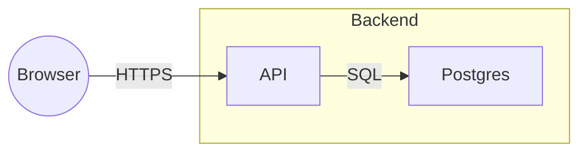

# Milestone 0: Skeleton Implementation Plan

> **For agentic workers:** REQUIRED SUB-SKILL: Use superpowers:subagent-driven-development (recommended) or superpowers:executing-plans to implement this plan task-by-task. Steps use checkbox (`- [ ]`) syntax for tracking.

**Goal:** A `blueprint` command that serves the web UI from a repository, saves Excalidraw boards and Markdown docs under `.blueprint/`, and produces the deterministic board export with golden tests.

**Architecture:** One npm package with three parts: a Node server (Hono plus a WebSocket) that owns the files under `.blueprint/` and the export, a React UI (Vite) with a board view, a doc view, and a sidebar, and a CLI that initializes the folder, starts the server, and opens the browser. The export is a pure module with no I/O. No Claude in this milestone; the right pane is a placeholder for milestone 1.

**Tech Stack:** TypeScript strict, ESM, pnpm, Node 20+, Hono with `@hono/node-server` and `@hono/node-ws`, chokidar, Zod 4, React 19, Vite, `@excalidraw/excalidraw`, CodeMirror 6, Vitest, Testing Library, Biome.

**Spec:** `docs/build-plan.md` (sections 3, 4, 5, 6.1, 6.2, 6.3, 6.8, 6.9, 7, 8 row 0, 9, 10).

## Global Constraints

- Node 20 or later; TypeScript strict mode; ESM throughout.
- Plan data is plain files under `.blueprint/` in the user's repository; the server is the only writer; writes are atomic.
- Excalidraw element IDs are never regenerated or rewritten by Blueprint.
- Board files hold no embedded image data; images are extracted to `.blueprint/assets/<sha256>.<ext>` and referenced by relative path.
- `.blueprint/export/` and `.blueprint/worktrees/` are ignored by git; everything else under `.blueprint/` is committed.
- No API key, no network calls to any Blueprint-run service, no "Claude Code" branding anywhere in UI copy or package metadata.
- Board and doc names are slugs matching `^[a-z0-9][a-z0-9-]*$`; docs are stored as `<name>.md`.
- The UI follows `DESIGN.md` at the repository root when it exists; otherwise the fallback tokens in Task 0.
- Commit messages use conventional commits and carry no co-author trailer (user rule).
- Markdown written by hand in this repo puts each sentence on its own line and never uses an em dash (user rule).

## Review Focus

1. Names with spaces, uppercase, `..`, or slashes sent to the API must be rejected with 400 and never touch the filesystem. Pinned in Task 6.
2. A scene whose image `dataURL` is malformed or not base64 must fail with 400 and write nothing, not leave a half-written board or asset. Pinned in Task 5.
3. A doc that changes on disk while the editor holds unsaved text must show the keep-or-take banner and never silently overwrite either side. Pinned in Task 10.
4. Labels containing double quotes, pipes, square brackets, or newlines must produce a Mermaid flowchart that still parses. Pinned in Task 3.
5. An arrow bound to an element that is deleted or missing must be treated as a free end, not crash or cite a ghost ID. Pinned in Task 2.

---

### Task 0: Design pass (outside the executor)

Vincent and Claude run `/design-consultation` in an interactive session before the UI tasks start, producing `DESIGN.md` at the repository root.
If `DESIGN.md` is absent when Task 8 begins, the executor uses these fallback tokens and a later milestone restyles:

- Font: `system-ui, -apple-system, "Segoe UI", sans-serif`, base size 14px, line height 1.5.
- Spacing: an 8px grid.
- Colors: background `#ffffff`, surface `#f6f7f9`, border `#e3e6ea`, text `#1f2328`, muted text `#656d76`, accent `#2563eb`.
- Layout: left rail 240px, right pane 360px, main fills the rest.

No code; no commit.

---

### Task 1: Repository bootstrap

**Files:**
- Create: `package.json`, `tsconfig.json`, `tsconfig.server.json`, `biome.json`, `vitest.config.ts`, `.gitignore`, `src/shared/types.ts`
- Test: `test/smoke.test.ts`

**Interfaces:**
- Produces: `pnpm check` (typecheck, lint, tests), `pnpm test`, `pnpm build`, `pnpm dev` scripts; path layout `src/{cli,server,export,ui,shared}` and `test/`.

- [ ] **Step 1: Initialize git state and ignore files**

`.gitignore` contents:

```
node_modules/
dist/
.DS_Store
.blueprint/export/
.blueprint/worktrees/
```

- [ ] **Step 2: Write `package.json`**

Fields the implementer must set: `"name": "blueprint"`, `"private": true`, `"type": "module"`, `"bin": { "blueprint": "dist/cli/index.js" }`, `"engines": { "node": ">=20" }`, `"packageManager": "pnpm@<installed version>"`.
Scripts:

```json
{
  "dev": "concurrently -n server,ui \"tsx watch src/cli/index.ts --no-open\" \"vite\"",
  "build": "tsc -p tsconfig.server.json && vite build",
  "check": "tsc --noEmit -p tsconfig.json && biome check . && vitest run",
  "test": "vitest run",
  "test:watch": "vitest"
}
```

Dependencies: `hono`, `@hono/node-server`, `@hono/node-ws`, `chokidar`, `zod`, `react`, `react-dom`, `@excalidraw/excalidraw`, `codemirror`, `@codemirror/lang-markdown`, `@codemirror/state`, `@codemirror/view`.
Dev dependencies: `typescript`, `tsx`, `vite`, `@vitejs/plugin-react`, `vitest`, `jsdom`, `@testing-library/react`, `@testing-library/jest-dom`, `@testing-library/user-event`, `@biomejs/biome`, `concurrently`, `@types/node`, `@types/react`, `@types/react-dom`.
Use the latest stable of each.

- [ ] **Step 3: Write the TypeScript configs**

`tsconfig.json`: `strict: true`, `target: ES2022`, `module: ESNext`, `moduleResolution: bundler`, `jsx: react-jsx`, `noEmit: true`, `include: ["src", "test"]`, `types: ["node", "vitest/globals"]`.
`tsconfig.server.json`: extends base, `noEmit: false`, `outDir: dist`, `rootDir: src`, `module: NodeNext`, `moduleResolution: NodeNext`, `include: ["src/cli", "src/server", "src/export", "src/shared"]`.

- [ ] **Step 4: Write `biome.json` and `vitest.config.ts`**

Biome: recommended rules, formatter with 2-space indent and double quotes, `files.ignore` for `dist` and `test/export/fixtures`.
Vitest: `environment: "node"`, `globals: true`, `include: ["test/**/*.test.ts", "test/**/*.test.tsx"]`, `setupFiles: ["test/setup.ts"]`.
Create `test/setup.ts` containing the single line `import "@testing-library/jest-dom/vitest";`.

- [ ] **Step 5: Write the shared types stub and the smoke test**

`src/shared/types.ts` exports `export const APP_NAME = "Blueprint";`.
`test/smoke.test.ts`:

```ts
import { APP_NAME } from "../src/shared/types";
test("smoke", () => { expect(APP_NAME).toBe("Blueprint"); });
```

- [ ] **Step 6: Install and run the check**

Run: `pnpm install && pnpm check`
Expected: typecheck clean, Biome clean, 1 test passed.

- [ ] **Step 7: Commit**

```bash
git add .gitignore package.json pnpm-lock.yaml tsconfig.json tsconfig.server.json biome.json vitest.config.ts src/shared/types.ts test/setup.ts test/smoke.test.ts docs/
git commit -m "chore: bootstrap blueprint package and commit design docs"
```

---

### Task 2: Export schema and BoardGraph

**Files:**
- Create: `src/export/schema.ts`, `src/export/boardGraph.ts`, `src/export/index.ts`
- Test: `test/export/boardGraph.test.ts`

**Interfaces:**
- Produces (from `src/export/schema.ts`): Zod schemas and inferred types `ExcalidrawElement`, `BoardFileAsset`, `BoardFile`, `BoardNode`, `BoardEdge`, `BoardLoose`, `BoardGraph`.
- Produces (from `src/export/boardGraph.ts`): `excalidrawToBoardGraph(board: BoardFile, boardName: string): BoardGraph`.

- [ ] **Step 1: Write the schemas**

```ts
export const ExcalidrawElement = z.object({
  id: z.string(), type: z.string(), isDeleted: z.boolean().optional(),
  x: z.number(), y: z.number(), width: z.number(), height: z.number(),
  text: z.string().optional(), containerId: z.string().nullable().optional(),
  boundElements: z.array(z.object({ id: z.string(), type: z.string() })).nullable().optional(),
  startBinding: z.object({ elementId: z.string() }).loose().nullable().optional(),
  endBinding: z.object({ elementId: z.string() }).loose().nullable().optional(),
  startArrowhead: z.string().nullable().optional(), endArrowhead: z.string().nullable().optional(),
  frameId: z.string().nullable().optional(), name: z.string().nullable().optional(),
  fileId: z.string().nullable().optional(), customData: z.record(z.string(), z.unknown()).optional(),
}).loose();
export const BoardFileAsset = z.object({ id: z.string(), mimeType: z.string(), created: z.number(), asset: z.string() });
export const BoardFile = z.object({
  type: z.literal("excalidraw"), version: z.number(), source: z.string().optional(),
  elements: z.array(ExcalidrawElement),
  appState: z.record(z.string(), z.unknown()).default({}),
  files: z.record(z.string(), BoardFileAsset).default({}),
});
export const BoardNode = z.object({
  id: z.string(), kind: z.enum(["box", "ellipse", "diamond", "text", "image", "frame"]),
  label: z.string(), frameId: z.string().nullable(), asset: z.string().optional(),
  bounds: z.object({ x: z.number(), y: z.number(), w: z.number(), h: z.number() }),
  origin: z.enum(["human", "ai"]),
});
export const BoardEdge = z.object({
  id: z.string(), from: z.string().nullable(), to: z.string().nullable(), label: z.string(),
  arrowheads: z.object({ start: z.boolean(), end: z.boolean() }),
});
export const BoardLoose = z.object({ id: z.string(), kind: z.enum(["draw", "line"]) });
export const BoardGraph = z.object({ board: z.string(), nodes: z.array(BoardNode), edges: z.array(BoardEdge), loose: z.array(BoardLoose) });
```

- [ ] **Step 2: Write the failing tests**

Build elements with a small `el(overrides)` helper in the test file that fills required numeric fields with zeros.

```ts
test("rectangle with bound text becomes a box node with the text as label", () => {
  const g = excalidrawToBoardGraph(board([
    el({ id: "r1", type: "rectangle", boundElements: [{ id: "t1", type: "text" }] }),
    el({ id: "t1", type: "text", text: "API", containerId: "r1" }),
  ]), "main");
  expect(g.nodes).toEqual([expect.objectContaining({ id: "r1", kind: "box", label: "API", frameId: null, origin: "human" })]);
});
test("arrow bound at both ends becomes an edge with label and arrowheads", () => {
  // r1, r2 as above; a1 with startBinding r1, endBinding r2, endArrowhead "arrow", bound text "SQL"
  expect(g.edges).toEqual([{ id: "a1", from: "r1", to: "r2", label: "SQL", arrowheads: { start: false, end: true } }]);
});
test("arrow bound to a deleted or missing element has a free end", () => {
  // a1 endBinding points at r9 which has isDeleted true; a2 startBinding points at "nope"
  expect(g.edges.map(e => [e.from, e.to])).toEqual([["r1", null], [null, "r1"]]);
});
test("deleted elements are skipped entirely", ...);          // isDeleted rectangle produces no node
test("frames become frame nodes and children carry frameId", ...);  // frame fr1 name "Backend", rectangle with frameId fr1
test("unbound text, images, freedraw and line are classified", () => {
  // text t1 (containerId null) -> node kind text label from text
  // image img1 fileId "f1", board.files.f1.asset "assets/abc.png" -> node kind image, asset "assets/abc.png"
  // freedraw d1 -> loose draw; line l1 -> loose line
});
test("customData origin ai is carried through", ...);
test("node order follows element order", ...);
```

- [ ] **Step 3: Run the tests to verify they fail**

Run: `pnpm vitest run test/export/boardGraph.test.ts`
Expected: FAIL, module not found.

- [ ] **Step 4: Implement `excalidrawToBoardGraph` in `src/export/boardGraph.ts`**

Rules the tests do not fully determine: skip any element with `isDeleted`; a container's label is the trimmed `text` of its bound text element; kinds map rectangle to box, ellipse to ellipse, diamond to diamond, unbound text to text, image to image, frame to frame; arrows become edges whose `from` and `to` are the binding's `elementId` only when that element exists and is not deleted; `arrowheads.start` is `Boolean(startArrowhead)` and `arrowheads.end` is `Boolean(endArrowhead)`; freedraw becomes loose `draw` and line becomes loose `line`; other types are ignored; `origin` is `"ai"` only when `customData.origin === "ai"`; image `asset` comes from `board.files[fileId].asset`.
Export everything from `src/export/index.ts`.

- [ ] **Step 5: Run the tests to verify they pass**

Run: `pnpm vitest run test/export/boardGraph.test.ts`
Expected: PASS, 8 tests.

- [ ] **Step 6: Commit**

```bash
git add src/export test/export/boardGraph.test.ts
git commit -m "feat(export): board schema and Excalidraw to BoardGraph"
```

---

### Task 3: Markdown renderer with golden fixture

**Files:**
- Create: `src/export/markdown.ts`, `test/export/fixtures/basic.excalidraw.json`, `test/export/fixtures/basic.md`
- Modify: `src/export/index.ts`
- Test: `test/export/markdown.test.ts`

**Interfaces:**
- Produces: `boardGraphToMarkdown(graph: BoardGraph): string` and `mermaidLabel(text: string): string`.

- [ ] **Step 1: Write the fixture scene**

`basic.excalidraw.json` is a `BoardFile` with, in this element order: frame `fr1` named `Backend`; rectangle `r1` label `API` in `fr1`; rectangle `r2` label `Postgres` in `fr1`; ellipse `e1` label `Browser`; arrow `a1` from `r1` to `r2` label `SQL` with end arrowhead; arrow `a2` from `e1` to `r1` label `HTTPS` with end arrowhead; arrow `a3` from `r2` with no end binding and no label; text `t1` with text `Open question: auth?`; image `img1` with `fileId` `f1`; freedraw `d1`; rectangle `r9` with `isDeleted: true`. The `files` map has `f1` with asset `assets/abc.png`. Bound text elements carry the labels.

- [ ] **Step 2: Write the expected golden output**

`basic.md` is exactly:

````markdown
# Board: main

## Diagram



<!-- ids: n1=fr1 n2=r1 n3=r2 n4=e1 -->

## Unconnected arrows

- a3: "Postgres" (r2) -> (free)

## Other elements

- [text] Open question: auth? (t1)
- [image] assets/abc.png (img1)
- 1 freehand stroke, 0 lines
````

- [ ] **Step 3: Write the failing tests**

```ts
test("golden: basic board renders exactly", async () => {
  const board = BoardFile.parse(JSON.parse(await readFile(fixture("basic.excalidraw.json"), "utf8")));
  expect(boardGraphToMarkdown(excalidrawToBoardGraph(board, "main"))).toBe(await readFile(fixture("basic.md"), "utf8"));
});
test("labels are escaped for Mermaid", () => {
  expect(mermaidLabel('Say "hi" | [x]\nnext')).toBe("Say #quot;hi#quot; #124; #91;x#93; next");
  expect(mermaidLabel("   ")).toBe("(unlabeled)");
});
test("both arrowheads render <-->, none renders ---, start-only is reversed", ...);
test("a frame with no connected children is not a subgraph; its nodes list under Other elements with (in <frame>)", ...);
test("diamond renders n{\"label\"}", ...);
test("a board with no edges has no Diagram section and no ids comment", ...);
```

- [ ] **Step 4: Run the tests to verify they fail**

Run: `pnpm vitest run test/export/markdown.test.ts`
Expected: FAIL, `boardGraphToMarkdown` not found.

- [ ] **Step 5: Implement `boardGraphToMarkdown` and `mermaidLabel` in `src/export/markdown.ts`**

Rules beyond the golden file: a node is connected when it appears as `from` or `to` of an edge whose ends are both non-null; the Diagram section exists only when at least one such edge exists; sanitized IDs `n1, n2, ...` are assigned in node order to frames that contain a connected node and to connected nodes; a frame becomes `subgraph nK["name"]` wrapping its connected children; shapes render as box `nK["label"]`, ellipse `nK(("label"))`, diamond `nK{"label"}`, text and image `nK["label"]` where an image's label is its asset path; edges render `-->` for end only, `<-->` for both, `---` for none, and start-only swaps the endpoints and renders `-->`; an edge label renders as `|"label"|` after the arrow; the ids comment lists every sanitized ID in order; unconnected arrows render one bullet each with `"label" (id)` or `(free)` per side and ` label "x"` appended when the edge has a label; Other elements lists unconnected nodes in node order as `- [kind] label (id)` with ` (in <frame name>)` appended for framed ones, images as `- [image] <asset> (id)`, and a final stroke summary line with singular and plural forms; sections with nothing to show are omitted except the title.
`mermaidLabel` collapses whitespace, replaces `"` with `#quot;`, `|` with `#124;`, `[` with `#91;`, `]` with `#93;`, and returns `(unlabeled)` for empty input.

- [ ] **Step 6: Run the tests to verify they pass**

Run: `pnpm vitest run test/export/markdown.test.ts`
Expected: PASS, 6 tests.

- [ ] **Step 7: Commit**

```bash
git add src/export/markdown.ts src/export/index.ts test/export/markdown.test.ts test/export/fixtures
git commit -m "feat(export): BoardGraph to Markdown with Mermaid and golden fixture"
```

---

### Task 4: Citations

**Files:**
- Create: `src/export/citations.ts`
- Modify: `src/export/index.ts`
- Test: `test/export/citations.test.ts`

**Interfaces:**
- Produces: `type Citation = { kind: "board" | "doc"; page: string; id: string; raw: string }`, `parseCitations(text: string): Citation[]`, `headingSlugs(markdown: string): string[]`, `buildCitationIndex(input: { boards: Record<string, BoardGraph>; docs: Record<string, string> }): Set<string>`, `dropUnknownCitations(text: string, index: Set<string>): { text: string; dropped: Citation[] }`.

- [ ] **Step 1: Write the failing tests**

```ts
test("parses board and doc citations", () => {
  expect(parseCitations("see [[board:main#r1]] and [[doc:api.md#auth-flow]]")).toEqual([
    { kind: "board", page: "main", id: "r1", raw: "[[board:main#r1]]" },
    { kind: "doc", page: "api.md", id: "auth-flow", raw: "[[doc:api.md#auth-flow]]" },
  ]);
});
test("heading slugs follow GitHub rules", () => {
  expect(headingSlugs("# Auth Flow\n## Step 2: Tokens!\ntext\n### A  B")).toEqual(["auth-flow", "step-2-tokens", "a--b"]);
});
test("index keys are board:<name>#<id> for nodes, edges and loose, and doc:<file>#<slug>", ...);
test("unknown citations are removed from the text and reported", () => {
  const r = dropUnknownCitations("x [[board:main#r1]] y [[board:main#zzz]]", new Set(["board:main#r1"]));
  expect(r.text).toBe("x [[board:main#r1]] y ");
  expect(r.dropped.map(c => c.raw)).toEqual(["[[board:main#zzz]]"]);
});
```

- [ ] **Step 2: Run the tests to verify they fail**

Run: `pnpm vitest run test/export/citations.test.ts`
Expected: FAIL, module not found.

- [ ] **Step 3: Implement `src/export/citations.ts`**

Citation regex: `/\[\[(board|doc):([^#\]]+)#([^\]]+)\]\]/g`.
Slug rule: lowercase, strip characters that are not letters, digits, spaces, or hyphens, replace each space with a hyphen.

- [ ] **Step 4: Run the tests to verify they pass**

Run: `pnpm vitest run test/export/citations.test.ts`
Expected: PASS, 4 tests.

- [ ] **Step 5: Commit**

```bash
git add src/export/citations.ts src/export/index.ts test/export/citations.test.ts
git commit -m "feat(export): citation grammar, heading slugs and index"
```

---

### Task 5: FileStore

**Files:**
- Create: `src/server/files.ts`
- Modify: `src/shared/types.ts`
- Test: `test/server/files.test.ts`

**Interfaces:**
- Consumes: `BoardFile`, `BoardFileAsset` from Task 2.
- Produces in `src/shared/types.ts`, so the UI can import them without touching server code:

```ts
export type IncomingFile = { id: string; mimeType: string; created: number; dataURL?: string; asset?: string };
export type IncomingScene = { elements: unknown[]; appState: Record<string, unknown>; files: Record<string, IncomingFile> };
```

- Produces in `src/server/files.ts`:

```ts
export class InvalidNameError extends Error {}
export class NotFoundError extends Error {}
export class ExistsError extends Error {}
export class InvalidSceneError extends Error {}
export function assertSlug(name: string): void;
export class FileStore {
  constructor(root: string);
  readonly dir: string;                       // <root>/.blueprint
  init(): Promise<void>;
  listBoards(): Promise<{ name: string; updatedAt: string }[]>;
  createBoard(name: string): Promise<BoardFile>;
  readBoard(name: string): Promise<BoardFile>;
  writeBoard(name: string, scene: IncomingScene): Promise<BoardFile>;
  listDocs(): Promise<{ name: string; updatedAt: string }[]>;
  createDoc(name: string): Promise<void>;
  readDoc(name: string): Promise<string>;
  writeDoc(name: string, text: string): Promise<void>;
  readAsset(file: string): Promise<Buffer>;
  writeExport(relPath: string, data: Buffer | string): Promise<void>;
  wasWrittenRecently(absPath: string, withinMs: number): boolean;
}
```

- [ ] **Step 1: Write the failing tests** (each test gets a fresh temp dir via `mkdtemp`)

```ts
test("init creates the directories and appends gitignore lines once", async () => {
  await store.init(); await store.init();
  for (const d of ["boards", "docs", "assets", "tasks", "export", "worktrees"]) expect(existsSync(join(store.dir, d))).toBe(true);
  const gi = await readFile(join(root, ".gitignore"), "utf8");
  expect(gi.match(/\.blueprint\/export\//g)).toHaveLength(1);
  expect(gi.match(/\.blueprint\/worktrees\//g)).toHaveLength(1);
});
test("assertSlug accepts a-z0-9- and rejects the rest", () => {
  for (const ok of ["main", "api-v2", "x1"]) expect(() => assertSlug(ok)).not.toThrow();
  for (const bad of ["Main", "a b", "../x", "a/b", "-a", ""]) expect(() => assertSlug(bad)).toThrow(InvalidNameError);
});
test("createBoard writes an empty scene and refuses duplicates", ...);   // second create rejects with ExistsError; file content parses as BoardFile with elements []
test("writeBoard extracts a dataURL image to assets by sha256 and rewrites the reference", async () => {
  const png = Buffer.from([0x89, 0x50, 0x4e, 0x47]);
  const stored = await store.writeBoard("main", scene({ files: { f1: { id: "f1", mimeType: "image/png", created: 1, dataURL: `data:image/png;base64,${png.toString("base64")}` } } }));
  const sha = createHash("sha256").update(png).digest("hex");
  expect(stored.files.f1).toEqual({ id: "f1", mimeType: "image/png", created: 1, asset: `assets/${sha}.png` });
  expect(await readFile(join(store.dir, "assets", `${sha}.png`))).toEqual(png);
  expect(JSON.parse(await readFile(join(store.dir, "boards", "main.excalidraw.json"), "utf8")).files.f1.asset).toBe(`assets/${sha}.png`);
});
test("writeBoard keeps existing asset references and element ids untouched", ...);  // file with asset only, element ids identical after round trip
test("writeBoard rejects a malformed dataURL and writes nothing", async () => {
  await store.createBoard("main");
  const before = await readFile(boardPath, "utf8");
  await expect(store.writeBoard("main", scene({ files: { f1: { id: "f1", mimeType: "image/png", created: 1, dataURL: "data:image/png;base64,***" } } }))).rejects.toThrow(InvalidSceneError);
  expect(await readFile(boardPath, "utf8")).toBe(before);
  expect(await readdir(join(store.dir, "assets"))).toEqual([]);
});
test("writes are atomic: no temp files remain and content is complete", ...);
test("docs round trip and list with updatedAt", ...);
test("readBoard and readDoc throw NotFoundError", ...);
test("wasWrittenRecently is true right after a write and false after the window", ...);
```

- [ ] **Step 2: Run the tests to verify they fail**

Run: `pnpm vitest run test/server/files.test.ts`
Expected: FAIL, module not found.

- [ ] **Step 3: Implement `src/server/files.ts`**

Decisions: board path is `boards/<name>.excalidraw.json`; stored JSON is `JSON.stringify(board, null, 2) + "\n"`; empty scene is `{ type: "excalidraw", version: 2, source: "blueprint", elements: [], appState: {}, files: {} }`; the asset extension comes from a map `{ "image/png": "png", "image/jpeg": "jpg", "image/gif": "gif", "image/svg+xml": "svg", "image/webp": "webp" }` and any other MIME type is an `InvalidSceneError`; base64 is validated with a strict regex before decoding and a decode that yields zero bytes is invalid; atomic writes go to `<path>.tmp-<random>` then `rename`; `wasWrittenRecently` reads a `Map<string, number>` the write methods fill; the gitignore lines are `.blueprint/export/` and `.blueprint/worktrees/`.

- [ ] **Step 4: Run the tests to verify they pass**

Run: `pnpm vitest run test/server/files.test.ts`
Expected: PASS, 10 tests.

- [ ] **Step 5: Commit**

```bash
git add src/server/files.ts src/shared/types.ts test/server/files.test.ts
git commit -m "feat(server): FileStore for .blueprint with asset extraction and atomic writes"
```

---

### Task 6: HTTP routes

**Files:**
- Create: `src/server/routes.ts`, `src/server/app.ts`
- Test: `test/server/routes.test.ts`

**Interfaces:**
- Consumes: `FileStore` and its errors from Task 5; `excalidrawToBoardGraph`, `boardGraphToMarkdown`, `BoardFile` from Tasks 2 and 3.
- Produces: `createApp(store: FileStore): Hono` with these routes and JSON errors `{ error: string }`:

| Method and path | Body | Response |
|---|---|---|
| GET `/api/boards` | | 200 `{ name, updatedAt }[]` |
| POST `/api/boards` | `{ name }` | 201 `BoardFile`; 400 invalid name; 409 exists |
| GET `/api/boards/:name` | | 200 `BoardFile`; 404 |
| PUT `/api/boards/:name` | `IncomingScene` | 200 stored `BoardFile`; 400 invalid name or scene; 404; also writes `export/boards/<name>.md` |
| POST `/api/boards/:name/png` | raw `image/png` bytes | 204; writes `export/boards/<name>.png` |
| GET `/api/docs` | | 200 list |
| POST `/api/docs` | `{ name }` | 201; 400; 409 |
| GET `/api/docs/:name` | | 200 `text/markdown`; 404 |
| PUT `/api/docs/:name` | text body | 204; 404 |
| GET `/api/assets/:file` | | 200 bytes with content type by extension; 404 |
| GET `/api/export/boards/:name.md` | | 200 `text/markdown` generated from the stored board; 404 |

- [ ] **Step 1: Write the failing tests** (use `app.request(path, init)` on a temp-dir store; no network)

```ts
test("board lifecycle: create, list, get, put, export", async () => {
  expect((await app.request("/api/boards", post({ name: "main" }))).status).toBe(201);
  expect(await (await app.request("/api/boards")).json()).toEqual([expect.objectContaining({ name: "main" })]);
  const put = await app.request("/api/boards/main", { method: "PUT", body: JSON.stringify(sceneWithTwoBoxesAndArrow), headers: json });
  expect(put.status).toBe(200);
  const md = await (await app.request("/api/export/boards/main.md")).text();
  expect(md).toContain("flowchart LR");
  expect(existsSync(join(store.dir, "export/boards/main.md"))).toBe(true);
});
test("invalid names are rejected with 400 and nothing is written", async () => {
  for (const name of ["Main", "a b", "..", "a/b"]) {
    expect((await app.request("/api/boards", post({ name }))).status).toBe(400);
    expect((await app.request(`/api/docs/${encodeURIComponent(name)}`, { method: "PUT", body: "x" })).status).toBe(400);
  }
  expect(await readdir(join(store.dir, "boards"))).toEqual([]);
});
test("duplicate create returns 409", ...);
test("missing board or doc returns 404 with { error }", ...);
test("malformed scene returns 400", ...);              // files.f1.dataURL "data:image/png;base64,***"
test("png upload writes export/boards/<name>.png", ...);
test("docs lifecycle with text/markdown content type", ...);
test("assets are served with the right content type and 404 otherwise", ...);
```

- [ ] **Step 2: Run the tests to verify they fail**

Run: `pnpm vitest run test/server/routes.test.ts`
Expected: FAIL, module not found.

- [ ] **Step 3: Implement `src/server/routes.ts` and `src/server/app.ts`**

`app.ts` creates the Hono app, registers routes, and maps `InvalidNameError` to 400, `InvalidSceneError` to 400, `NotFoundError` to 404, and `ExistsError` to 409 in one `onError` handler.
Content types for assets by extension: png, jpg, gif, svg, webp.
PUT on a board validates the name first, then that the board exists, then parses the scene.

- [ ] **Step 4: Run the tests to verify they pass**

Run: `pnpm vitest run test/server/routes.test.ts`
Expected: PASS, 8 tests.

- [ ] **Step 5: Commit**

```bash
git add src/server/routes.ts src/server/app.ts test/server/routes.test.ts
git commit -m "feat(server): REST routes for boards, docs, assets and export"
```

---

### Task 7: WebSocket hub, file watcher, and server start

**Files:**
- Create: `src/server/ws.ts`, `src/server/watch.ts`, `src/server/index.ts`, `src/shared/messages.ts`
- Test: `test/server/ws.test.ts`, `test/server/watch.test.ts`

**Interfaces:**
- Produces (`src/shared/messages.ts`): `export type ServerMessage = { type: "file-changed"; kind: "board" | "doc"; name: string }`.
- Produces (`src/server/ws.ts`): `class WsHub { add(socket: { send(data: string): void }): void; remove(socket): void; broadcast(msg: ServerMessage): void; get size(): number }`.
- Produces (`src/server/watch.ts`): `watchPlan(store: FileStore, onChange: (ev: { kind: "board" | "doc"; name: string }) => void): () => Promise<void>`.
- Produces (`src/server/index.ts`): `startServer(opts: { root: string; port: number; uiDir?: string }): Promise<{ port: number; close(): Promise<void> }>` which serves `createApp`, the `/ws` endpoint, the UI directory with an `index.html` fallback, and wires the watcher to the hub.

- [ ] **Step 1: Write the failing tests**

```ts
test("hub broadcasts JSON to every socket and drops removed ones", () => {
  const a = { send: vi.fn() }, b = { send: vi.fn() };
  hub.add(a); hub.add(b); hub.remove(b);
  hub.broadcast({ type: "file-changed", kind: "doc", name: "notes" });
  expect(a.send).toHaveBeenCalledWith(JSON.stringify({ type: "file-changed", kind: "doc", name: "notes" }));
  expect(b.send).not.toHaveBeenCalled();
});
test("watcher reports an external doc write and ignores the server's own write", async () => {
  // start watchPlan; await store.writeDoc("a", "x") -> no event within 300ms
  // then writeFile(join(store.dir, "docs", "b.md"), "y") directly -> event { kind: "doc", name: "b" } within 1500ms
});
test("watcher maps board files to kind board and strips the extension", ...);
```

- [ ] **Step 2: Run the tests to verify they fail**

Run: `pnpm vitest run test/server/ws.test.ts test/server/watch.test.ts`
Expected: FAIL, modules not found.

- [ ] **Step 3: Implement the hub, the watcher, and `startServer`**

Watcher: chokidar on `boards/` and `docs/` with `ignoreInitial: true` and `awaitWriteFinish: { stabilityThreshold: 100 }`; ignore paths for which `store.wasWrittenRecently(path, 1000)` is true; map `*.excalidraw.json` to board and `*.md` to doc.
Server: `@hono/node-ws` `createNodeWebSocket` for `/ws`; sockets join the hub on open and leave on close; the UI handler reads files from `uiDir` with a small extension-to-type map and falls back to `index.html` for unknown paths that do not start with `/api`; `close()` stops the watcher and the HTTP server.

- [ ] **Step 4: Run the tests to verify they pass**

Run: `pnpm vitest run test/server`
Expected: PASS for all server tests.

- [ ] **Step 5: Commit**

```bash
git add src/server/ws.ts src/server/watch.ts src/server/index.ts src/shared/messages.ts test/server/ws.test.ts test/server/watch.test.ts
git commit -m "feat(server): websocket hub, plan watcher and server start"
```

---

### Task 8: CLI

**Files:**
- Create: `src/cli/index.ts`, `src/cli/args.ts`, `src/cli/open.ts`
- Test: `test/cli/args.test.ts`

**Interfaces:**
- Consumes: `FileStore`, `startServer`.
- Produces: `parseArgs(argv: string[]): { command: "serve" | "init"; port: number; open: boolean }` and the `blueprint` binary.

- [ ] **Step 1: Write the failing tests**

```ts
test("defaults to serve on 4242 with open", () => expect(parseArgs([])).toEqual({ command: "serve", port: 4242, open: true }));
test("init, --port and --no-open", () => expect(parseArgs(["init", "--port", "5000", "--no-open"])).toEqual({ command: "init", port: 5000, open: false }));
test("unknown flag throws with the flag name", () => expect(() => parseArgs(["--bogus"])).toThrow("--bogus"));
```

- [ ] **Step 2: Run the test to verify it fails**

Run: `pnpm vitest run test/cli/args.test.ts`
Expected: FAIL, module not found.

- [ ] **Step 3: Implement the CLI**

`index.ts` starts with `#!/usr/bin/env node`, resolves `root` as `process.cwd()`, runs `store.init()` for both commands, and for `serve` calls `startServer` with `uiDir` resolved relative to the compiled file as `../ui`, prints `Blueprint running at http://localhost:<port>`, and opens the browser unless `--no-open`.
`open.ts` exports `openBrowser(url: string): void` that spawns `open` on darwin and `xdg-open` elsewhere, detached, ignoring failure.
`init` prints `Initialized .blueprint/ in <root>`.
In `pnpm dev` the UI is served by Vite on its own port with the proxy from Task 9; the API server's static route then points at the unbuilt `src/ui` and is simply not used.

- [ ] **Step 4: Run the test and the build**

Run: `pnpm vitest run test/cli/args.test.ts && pnpm tsc -p tsconfig.server.json && node dist/cli/index.js init`
Expected: tests PASS; the build succeeds; `.blueprint/` appears in this repository with the gitignore lines added.

- [ ] **Step 5: Commit**

```bash
git add src/cli test/cli .gitignore
git commit -m "feat(cli): blueprint serve and init commands"
```

---

### Task 9: UI shell, routing, and sidebar

**Files:**
- Create: `src/ui/index.html`, `src/ui/main.tsx`, `src/ui/App.tsx`, `src/ui/api.ts`, `src/ui/nav/Sidebar.tsx`, `src/ui/styles.css`, `vite.config.ts`
- Test: `test/ui/Sidebar.test.tsx`

**Interfaces:**
- Consumes: the REST routes from Task 6 and `ServerMessage` from Task 7.
- Produces (`src/ui/api.ts`): `listBoards()`, `createBoard(name)`, `getBoard(name): Promise<BoardFile>`, `saveBoard(name, scene: IncomingScene): Promise<BoardFile>`, `uploadBoardPng(name, blob: Blob)`, `listDocs()`, `createDoc(name)`, `getDoc(name): Promise<string>`, `saveDoc(name, text)`, `assetUrl(asset: string): string`, `connectWs(onMessage: (m: ServerMessage) => void): () => void` that reconnects with backoff.
- Produces (`src/ui/nav/Sidebar.tsx`): `Sidebar({ boards, docs, active, onCreateBoard, onCreateDoc }: { boards: string[]; docs: string[]; active: { kind: "board" | "doc"; name: string } | null; onCreateBoard(name: string): void; onCreateDoc(name: string): void })`.
- Routing: `#/boards/<name>` and `#/docs/<name>`; the default route opens the first board or shows an empty state.

- [ ] **Step 1: Write the failing test** (file starts with `// @vitest-environment jsdom`)

```tsx
test("lists boards and docs, marks the active one, and creates a board from a prompt", async () => {
  vi.spyOn(window, "prompt").mockReturnValue("new-board");
  const onCreateBoard = vi.fn();
  render(<Sidebar boards={["main"]} docs={["notes"]} active={{ kind: "board", name: "main" }} onCreateBoard={onCreateBoard} onCreateDoc={() => {}} />);
  expect(screen.getByRole("link", { name: "main" })).toHaveAttribute("aria-current", "page");
  expect(screen.getByRole("link", { name: "notes" })).toHaveAttribute("href", "#/docs/notes");
  await userEvent.click(screen.getByRole("button", { name: "New board" }));
  expect(onCreateBoard).toHaveBeenCalledWith("new-board");
});
```

- [ ] **Step 2: Run the test to verify it fails**

Run: `pnpm vitest run test/ui/Sidebar.test.tsx`
Expected: FAIL, module not found.

- [ ] **Step 3: Implement the shell**

`vite.config.ts`: `root: "src/ui"`, `build.outDir: "../../dist/ui"` with `emptyOutDir: true`, the React plugin, `define: { "process.env.IS_PREACT": JSON.stringify("false") }` (required by Excalidraw), and a dev proxy for `/api` to `http://localhost:4242` and `/ws` to `ws://localhost:4242` with `ws: true`.
`App.tsx`: three panes per the design tokens; the right pane shows the text `The Claude panel arrives in milestone 1.`; the sidebar reads lists from the API on mount and after creates; the main pane renders `BoardView` or `DocView` (Tasks 10 and 11; stub them as empty components here).
`Sidebar.tsx`: links as above; the create buttons call `window.prompt` and pass a trimmed non-empty result.

- [ ] **Step 4: Run the test and the build**

Run: `pnpm vitest run test/ui/Sidebar.test.tsx && pnpm vite build`
Expected: PASS; `dist/ui/index.html` exists.

- [ ] **Step 5: Commit**

```bash
git add src/ui vite.config.ts test/ui/Sidebar.test.tsx
git commit -m "feat(ui): app shell, hash routing, sidebar and api client"
```

---

### Task 10: Doc view

**Files:**
- Create: `src/ui/docs/DocView.tsx`, `src/ui/docs/reconcile.ts`, `src/ui/hooks/useDebounced.ts`
- Test: `test/ui/reconcile.test.ts`, `test/ui/useDebounced.test.ts`

**Interfaces:**
- Consumes: `getDoc`, `saveDoc`, `connectWs` from Task 9.
- Produces: `reconcileExternalChange(input: { dirty: boolean; localText: string; diskText: string }): "reload" | "banner" | "noop"`; `useDebounced<T>(fn: (v: T) => void, ms: number): (v: T) => void`; `DocView({ name }: { name: string })`.

- [ ] **Step 1: Write the failing tests**

```ts
test("clean editor reloads, dirty editor with a different disk text gets a banner, identical text is a noop", () => {
  expect(reconcileExternalChange({ dirty: false, localText: "a", diskText: "b" })).toBe("reload");
  expect(reconcileExternalChange({ dirty: true, localText: "a", diskText: "b" })).toBe("banner");
  expect(reconcileExternalChange({ dirty: true, localText: "a", diskText: "a" })).toBe("noop");
});
test("useDebounced calls once with the last value after the delay", ...);   // renderHook with fake timers, three calls within 500ms -> one call with the third value
```

- [ ] **Step 2: Run the tests to verify they fail**

Run: `pnpm vitest run test/ui/reconcile.test.ts test/ui/useDebounced.test.ts`
Expected: FAIL, modules not found.

- [ ] **Step 3: Implement the doc view**

CodeMirror: `EditorView` with `basicSetup`, `markdown()`, and an update listener that marks the doc dirty and calls the debounced save (500 ms); a successful save clears dirty when the saved text equals the current text.
On a `file-changed` message for this doc, fetch the disk text and apply `reconcileExternalChange`: `reload` replaces the editor content; `banner` shows two buttons, `Keep mine` (saves local text) and `Take theirs` (replaces content).

- [ ] **Step 4: Run the tests and verify by hand**

Run: `pnpm vitest run test/ui && pnpm dev`
Then: create a doc in the browser, type, confirm `.blueprint/docs/<name>.md` updates within a second; edit the file in another editor and confirm the banner appears when the editor is dirty and a silent reload when it is clean.
Expected: tests PASS and both manual checks hold.

- [ ] **Step 5: Commit**

```bash
git add src/ui/docs src/ui/hooks test/ui/reconcile.test.ts test/ui/useDebounced.test.ts
git commit -m "feat(ui): markdown doc view with autosave and external-change banner"
```

---

### Task 11: Board view

**Files:**
- Create: `src/ui/board/BoardView.tsx`, `src/ui/board/scene.ts`
- Test: `test/ui/scene.test.ts`

**Interfaces:**
- Consumes: `getBoard`, `saveBoard`, `uploadBoardPng`, `assetUrl`, `connectWs` from Task 9; `useDebounced` from Task 10.
- Produces (`src/ui/board/scene.ts`): `toSaveBody(elements: readonly unknown[], appState: Record<string, unknown>, files: Record<string, { id: string; mimeType: string; created: number; dataURL: string }>): IncomingScene` and `filesWithDataUrls(stored: BoardFile, fetchAsset: (asset: string) => Promise<Blob>): Promise<Record<string, { id: string; mimeType: string; created: number; dataURL: string }>>`.

- [ ] **Step 1: Write the failing tests**

```ts
test("toSaveBody keeps elements and files and reduces appState to the persisted subset", () => {
  const body = toSaveBody([{ id: "r1" }], { viewBackgroundColor: "#fff", collaborators: new Map(), selectedElementIds: { r1: true } }, {});
  expect(body.elements).toEqual([{ id: "r1" }]);
  expect(body.appState).toEqual({ viewBackgroundColor: "#fff" });
});
test("filesWithDataUrls fetches each asset and builds a data URL", async () => {
  const emptyBoard: BoardFile = { type: "excalidraw", version: 2, elements: [], appState: {}, files: {} };
  const stored = { ...emptyBoard, files: { f1: { id: "f1", mimeType: "image/png", created: 1, asset: "assets/x.png" } } };
  const files = await filesWithDataUrls(stored, async () => new Blob([new Uint8Array([1, 2, 3])], { type: "image/png" }));
  expect(files.f1.dataURL).toBe("data:image/png;base64,AQID");
});
```

- [ ] **Step 2: Run the tests to verify they fail**

Run: `pnpm vitest run test/ui/scene.test.ts`
Expected: FAIL, module not found.

- [ ] **Step 3: Implement the board view**

`toSaveBody` keeps only these appState keys: `viewBackgroundColor`, `gridSize`, `gridModeEnabled`, `zoom`, `scrollX`, `scrollY`.
`filesWithDataUrls` builds each data URL from `await blob.arrayBuffer()` and `btoa`, not `FileReader`, so it runs in the browser and in Node tests alike.
`BoardView` loads the board and its asset data URLs, renders `<Excalidraw initialData={{ elements, appState, files }} onChange excalidrawAPI />` with the Excalidraw CSS imported once, saves 500 ms after the last change only when `getSceneVersion(elements)` changed since the last save, and 2 s after the last change exports a PNG with `exportToBlob({ elements, appState, files, mimeType: "image/png", exportPadding: 16 })` and uploads it.
On a `file-changed` message for this board: if the scene version equals the last saved version, reload the board into the editor with `updateScene` and `addFiles`; otherwise show a notice `Board changed on disk. Reload to see it.` with a reload button.

- [ ] **Step 4: Run the tests and verify by hand**

Run: `pnpm vitest run test/ui/scene.test.ts && pnpm dev`
Then: create a board, draw two boxes and an arrow, paste an image, and confirm within three seconds that `.blueprint/boards/<name>.excalidraw.json` has no `dataURL`, `.blueprint/assets/` has the image, and `.blueprint/export/boards/<name>.md` and `.png` exist; reload the page and confirm the drawing and image come back.
Expected: tests PASS and the manual checks hold.

- [ ] **Step 5: Commit**

```bash
git add src/ui/board test/ui/scene.test.ts
git commit -m "feat(ui): Excalidraw board view with autosave, asset extraction and PNG export"
```

---

### Task 12: Milestone acceptance

**Files:**
- Modify: `package.json` (no change expected), none otherwise.

- [ ] **Step 1: Full check**

Run: `pnpm check`
Expected: typecheck clean, Biome clean, all tests pass.

- [ ] **Step 2: Production run in a scratch repository**

Run:

```bash
pnpm build && mkdir -p /tmp/bp-scratch && cd /tmp/bp-scratch && git init -q && node /Users/vincentyip/programming/cursor-whiteboard/dist/cli/index.js --no-open
```

Then open `http://localhost:4242`, create a board and a doc, draw, type, and confirm the files under `/tmp/bp-scratch/.blueprint/` and the two gitignore lines in `/tmp/bp-scratch/.gitignore`.
Expected: the milestone 0 "done when" row in `docs/build-plan.md` section 8 holds.

- [ ] **Step 3: Commit any fixes**

```bash
git add -A && git commit -m "fix: milestone 0 acceptance fixes"
```

Only if Step 1 or Step 2 required changes.
