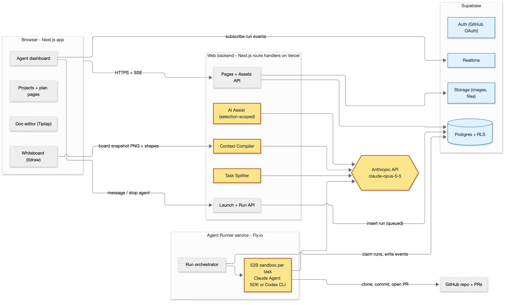

## 1. Business Context Summary

**Problem.**
Coding agents make engineers faster, but they remove engineers from the problem-solving step.
Plan modes produce long text files that are written for agents, so engineers skim them and ship code they cannot explain or debug.
Whiteboard tools such as Miro have no connection to agents.
Agent apps such as Codex keep planning text-based and AI-led.

**Solution.**
Blueprint is a planning workspace that sits between an idea and the code that agents write.
The user writes and draws the plan on document pages and whiteboard pages.
AI helps only when the user asks, and only on the text or region the user selects.
A compiler converts the pages into a specification that agents can read.
The compiler then splits the specification into parallel tasks.
One click starts one cloud agent per task.
The user can message each agent and send plan changes to running agents.

**Target users.**
The primary users are software engineers who build with Claude Code or Codex and want to understand what they ship.
The secondary users are CS students who learn system design and researchers who build prototypes.

**Success metrics.**

| Metric | Target | How we measure it |
|---|---|---|
| Human authorship ratio | The user types at least 70% of the words in a compiled plan | The editor tags every AI insertion, so the compiler can count human words and AI words |
| Time to first agent launch | A new user launches the first agent in under 30 minutes | Timestamps on project creation and first run |
| Agent rework | The user sends 2 or fewer follow-up messages per task (median). At least 70% of agent pull requests merge without a second run | We count messages and run outcomes per task |
| Plan comprehension | Users score at least 4 of 5 when they explain their architecture after a session | A survey after each session, and a 5-question quiz for a teammate who reads only the plan |

## 2. Architecture

**Components.**

- **Browser app** (Next.js, React).
  The left sidebar lists projects and plan pages.
  The center canvas shows either a tldraw whiteboard or a Tiptap document.
  The right panel lists the running agents.
- **Web backend** (Next.js route handlers on Vercel).
  The backend owns CRUD operations for projects, pages, and assets, and hosts the three services that call the model: AI Assist, Context Compiler, and Task Splitter.
- **Supabase**.
  Postgres stores all data and enforces row-level security.
  GitHub OAuth handles login and repository access.
  Storage holds images and files.
  Realtime pushes agent events to the dashboard.
- **Agent Runner** (Node service on Fly.io).
  The runner claims queued runs from Postgres and creates one E2B sandbox per task.
  It clones the repository into the sandbox and drives the agent with the Claude Agent SDK.
  Each sandbox streams its events back into Postgres.
  A runner adapter interface lets us add a Codex CLI runner after the alpha.

**Parts that interface directly with LLMs.**

| Component | Model and mode | Input | Output |
|---|---|---|---|
| AI Assist | `claude-opus-5-5`, streaming, low effort for wording edits | The selected text or board region (as shape JSON and a PNG snapshot), the user instruction, and the surrounding page content | A proposal: replacement text, tldraw shapes, or advice. The app applies nothing until the user accepts |
| Context Compiler | `claude-opus-5-5`, structured output, high effort | A deterministic representation of all pages: Markdown for documents, Mermaid plus PNG for boards, asset links, and the repository file tree | A specification with sections for goals, architecture, interfaces, constraints, acceptance criteria, and open questions. Each section cites its source page and shape IDs |
| Task Splitter | `claude-opus-5-5`, structured output | The approved specification | A task graph. Each task has a title, a task specification, dependencies, the files it will probably touch, and acceptance checks |
| Sandbox agent | Claude Agent SDK (the Claude Code harness) | The task specification, the project specification, and the repository | Commits on a branch, a pull request, and a stream of events |

**Data flow.**

The compiler runs in two stages, so the model never sees raw editor state.
Stage one is deterministic code.
It converts Tiptap JSON into Markdown, and it converts tldraw shapes and arrows into a Mermaid graph and a rendered PNG.
Stage two sends that representation to the model with a strict output schema.
Each specification version is an immutable row.
When the user edits the plan during a run, the compiler creates a new version.
The backend compares the new version with the version each agent started from and sends the difference into the running session as a message.

{width=66%}

## 3. API Design

All endpoints are Next.js route handlers under `/api`.
The Supabase session cookie authenticates each request.
Zod schemas, shared between client and server, validate each request.
Streaming endpoints use Server-Sent Events.

| Endpoint | Purpose | Input | Output |
|---|---|---|---|
| `POST, GET, PATCH /api/projects`, `/pages`, `/assets` | Create, read, and update projects, pages, and assets | A JSON body. Page updates include a `version` for autosave | The row, or 409 if the version is stale |
| `POST /api/ai/assist` | **LLM.** Help with the selected text or region | `{ pageId, selection: text or region, action: refine, diagram, advise, instruction }` | An SSE stream of a proposal. The client shows the proposal as a diff or as ghost shapes until the user accepts it |
| `POST /api/projects/:id/compile` | **LLM.** Compile the pages into a specification | None | A `SpecVersion` with Markdown and source references |
| `POST /api/specs/:id/split` | **LLM.** Split the specification into a task graph | `{ hints? }` | `Task[]` |
| `POST /api/specs/:id/launch` | Queue one run per task | `{ taskIds[], runner }` | `Run[]` with status `queued` |
| `GET /api/runs/:id/events?after=seq` | Replay events after a cursor | A query parameter `seq` | `RunEvent[]`. Live updates arrive through Supabase Realtime |
| `POST /api/runs/:id/messages` | Send a message to a running agent | `{ body }` | `Message` |
| `POST /api/runs/:id/stop` | Stop a run and delete its sandbox | None | `Run` |
| `POST /api/specs/:id/push-update` | Compare the newest specification with each active run and send the difference | None | `{ notified: runId[] }` |

**How the APIs interact with LLMs and external services.**

- The assist, compile, and split endpoints call the Anthropic Messages API from the web backend with the official TypeScript SDK.
  The compile and split endpoints use structured outputs, so each response matches our Zod schema.
  The backend sends board regions as both shape JSON and a PNG image, so the model can read labels and layout.
- The launch endpoint only writes rows.
  The runner polls the `runs` table with `FOR UPDATE SKIP LOCKED`.
  For each claimed run, the runner creates an E2B sandbox, clones the repository with the user's GitHub OAuth token, and starts the Claude Agent SDK with the task specification as the prompt.
  The SDK supports streaming input, so the runner can send later messages and plan differences into the same session.
  The runner writes every SDK message to the `run_events` table, and Realtime sends it to the dashboard.
  The agent commits to a `blueprint/<task-slug>` branch and opens a pull request through the GitHub API.
  The runner stores the pull request link on the run.

## 4. Technical Stack

- **Language.**
  We use TypeScript in strict mode for the web app, the runner, and the shared packages.
  Zod schemas validate every boundary, so an agent's mistake becomes a compile error or a validation error instead of a runtime bug.
- **Frontend.**
  We use Next.js 15, React 19, Tailwind CSS, and shadcn/ui, because they let us build a three-pane layout quickly.
  We use the tldraw SDK for the whiteboard, because it supports custom shapes, lets code create shapes for AI-drawn diagrams, and exports PNG images for the model to read.
  We use Tiptap (ProseMirror) for documents, because its JSON model and selection API make it simple to apply AI edits to a selection and tag AI-inserted text.
- **Backend and data.**
  We use Next.js route handlers on Vercel, so the API and the UI deploy together.
  We use Supabase with Drizzle ORM, because one managed service provides Postgres with row-level security, GitHub OAuth, file storage, a durable event log, and live updates.
- **LLM and agents.**
  We call the Anthropic API through `@anthropic-ai/sdk` with `claude-opus-5-5`, adaptive thinking, and structured outputs, because this gives the strongest planning quality and schema-safe compiler output.
  We use `@anthropic-ai/claude-agent-sdk` because it provides the full Claude Code harness.
  E2B sandboxes isolate the filesystem of each task.
  A Node (Hono) runner on Fly.io hosts the long-running agent sessions, because Vercel functions cannot.
  We will add a Codex CLI adapter after the alpha.
- **CI and testing.**
  We use GitHub Actions, Vercel preview deployments, the Supabase CLI for a local stack, Vitest, Playwright, and Testing Library, so every pull request is linted, tested, and previewed before merge.

## 5. Agent Readiness

- **Monorepo with clear boundaries.**
  The repository contains `apps/web`, `apps/runner`, and `packages/shared`, which holds the Zod schemas, the database types, and the deterministic compiler.
  Small, focused modules keep each file inside an agent's working context.
- **One source of truth for agent context.**
  `CLAUDE.md` holds the architecture summary, the commands, the conventions, and the definition of done.
  `AGENTS.md` is a symlink to the same file, so Codex reads the same context.
  After the alpha works, we will write plans in Blueprint and export them to this file, so the tool documents itself.
- **One-command local environment.**
  `pnpm dev` starts the web app, the runner, and a local Supabase stack with seed data.
  `pnpm check` runs the type checker, the linter, the unit tests, and the formatter, and an agent must pass it before it reports a task as done.
  A devcontainer and an `.env.example` file let a new agent or teammate start in minutes.
- **Test-driven workflow.**
  We write end-to-end test cases from the specification first, and each test case describes the expected behavior.
  Agents then generate the test code and the implementation.
  Playwright tests cover the three core flows: plan, compile, and launch.
- **CI and review gates.**
  GitHub Actions runs the linter, the tests, and the build on every push.
  It deploys a preview for every pull request and deploys to production on merge.
  A Claude Code GitHub Action reviews every pull request, and a teammate must approve it before merge.
  Skills in `.claude/skills` run the ship and review steps the same way every time.
  We log prompts in `docs/prompts/` for the final report.
