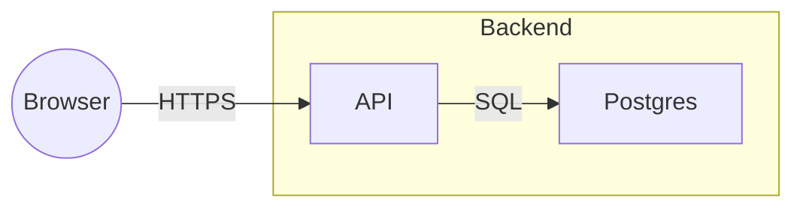

# Board: main

## Diagram

<!-- ids: n1=fr1 n2=r1 n3=r2 n4=e1 -->

## Arrows

- a1: "API" (r1) -> "Postgres" (r2) label "SQL"
- a2: "Browser" (e1) -> "API" (r1) label "HTTPS"

## Unconnected arrows

- a3: "Postgres" (r2) -> (free)

## Other elements

- [text] Open question: auth? (t1)
- [image] assets/abc.png (img1)
- 1 freehand stroke, 0 lines
